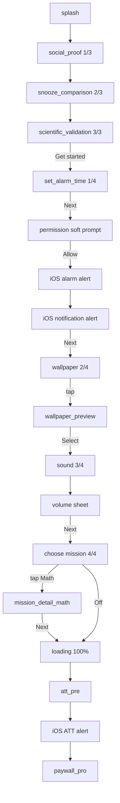
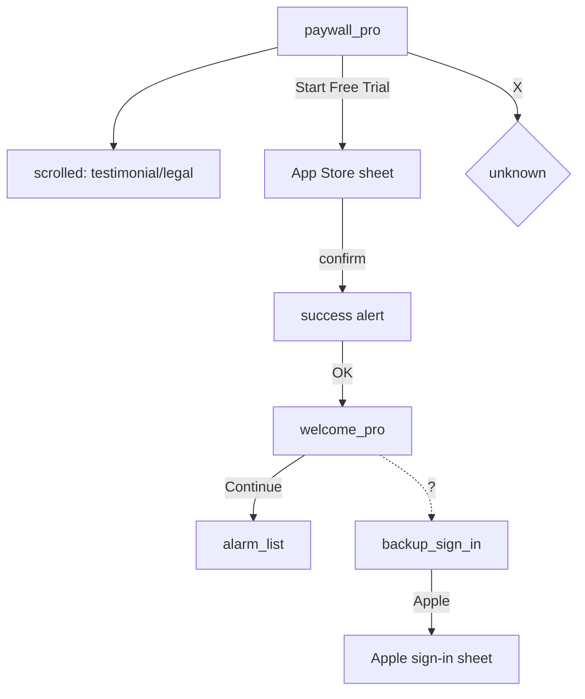
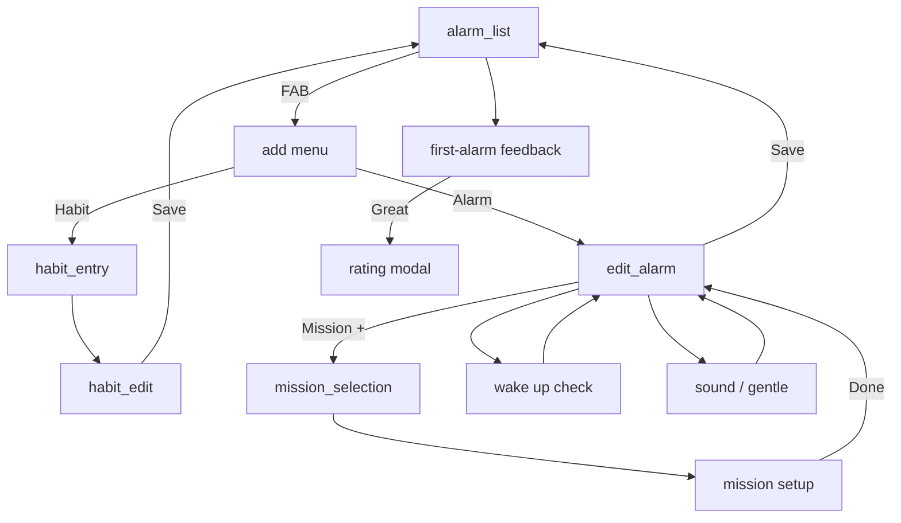
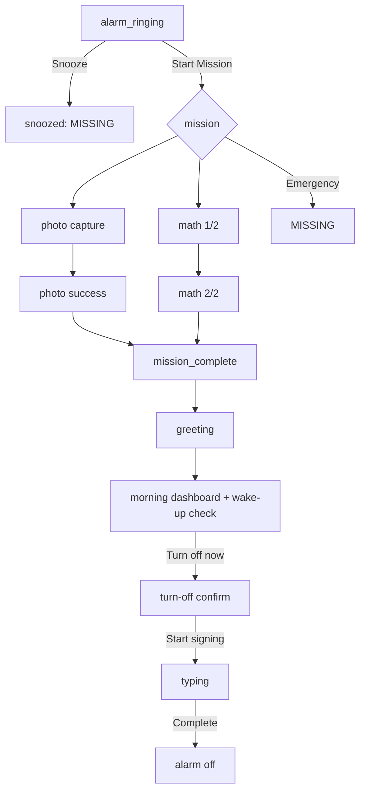
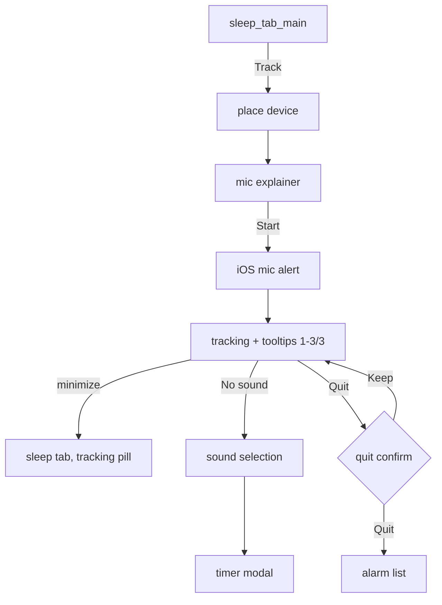
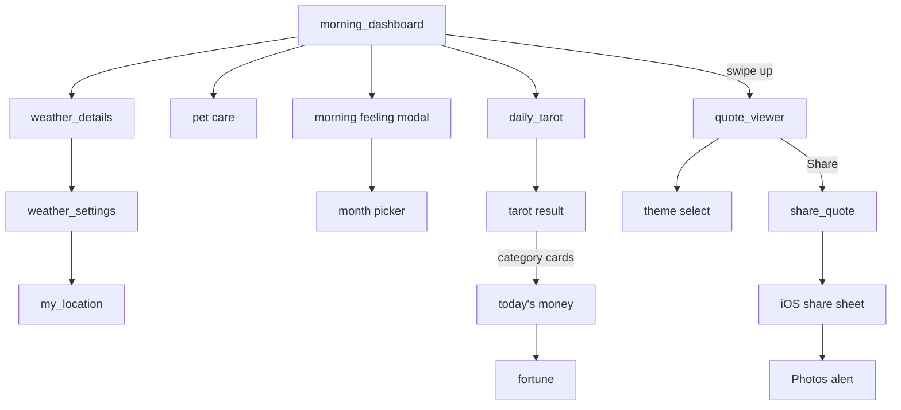
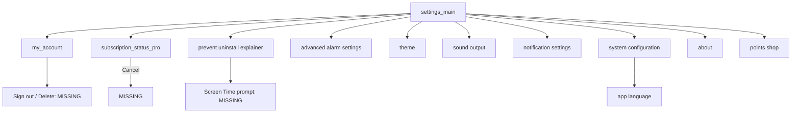

I have no file-writing tool in this session, so I can't create `FLOWS.md` on disk. The full content is below; save it as `C:\Users\Samsung\source\af\screen-re\FLOWS.md`.

---

# FLOWS.md ΓÇö Alarmy teardown

> Source: `out/screens.json`, 138 captures, files `alarmy-loud-alarm-clocksleep_<id>` (id column below). Facts come from the input; guesses are marked **(guess)**.
> Caveats:
> - The filenames carry no chapter prefix, so there are no chapter names. Order is capture order only.
> - "screensdesign" in status bars is a gallery watermark, not app UI.
> - Everything after the purchase (#21) was captured as a **Pro subscriber**, so locked and free states are mostly unseen.
> - Hex values in the input are model estimates.

## 1. Screen inventory

Rec = keep / merge→# / drop (duplicate of #).

| # | id | screen_name | type | purpose | rec |
|---|----|---|---|---|---|
| 1 | 284027 | splash_screen | other | Branded launch | keep |
| 2 | 284028 | onboarding_social_proof | onboarding | Rank/rating/downloads, intro 1/3 | keep |
| 3 | 284029 | onboarding_snooze_comparison | onboarding | "No more snoozing" vs other apps, 2/3 | keep |
| 4 | 284030 | onboarding_scientific_validation | onboarding | Medical credibility, "Get started", 3/3 | keep |
| 5 | 284031 | onboarding_set_alarm_time | onboarding | Time wheel, step 1/4 | keep |
| 6 | 284032 | onboarding_permission_request | permission | Custom Alarms + Notifications soft prompt | merge→#7,#8 (one template) |
| 7 | 284033 | onboarding_alarm_permission_modal | permission | iOS alarm/timer permission alert | keep |
| 8 | 284034 | onboarding_notification_permission | permission | iOS notification alert | keep |
| 9 | 284035 | onboarding_wallpaper_selection | onboarding | Wallpaper categories, 2/4 | keep |
| 10 | 284036 | wallpaper_preview | detail | Preview with date/time overlay, Select | keep |
| 11 | 284037 | alarm_sound_selection (onboarding) | onboarding | Sound chips + radio list, 3/4 | keep |
| 12 | 284038 | set_volume_modal | modal | Volume slider + gentle wake-up + Preview | keep |
| 13 | 284039 | choose_wake_up_mission | mission | Pick Math/Typing/Tiles/Shake/Off, 4/4 | keep |
| 14 | 284040 | mission_detail_math | mission | Mission explainer sheet | keep |
| 15 | 284041 | onboarding_loading_complete | onboarding | "Almost ready" 100% | keep |
| 16 | 284042 | att_pre_permission | permission | Pre-ATT explainer | keep |
| 17 | 284043 | att_permission_onboarding | permission | iOS ATT alert | keep |
| 18 | 284044 | paywall_pro | paywall | Yearly/Monthly/Lifetime, 7-day trial | keep |
| 19 | 284045 | paywall_subscription | paywall | Same paywall scrolled (testimonial, legal) | merge→#18 |
| 20 | 284046 | paywall_subscription_confirmation | paywall | App Store confirm sheet | keep |
| 21 | 284047 | purchase_success_modal | paywall | "You're all set" alert | keep |
| 22 | 284048 | welcome_pro_success | paywall | Pro unlocked summary + Continue | keep |
| 23 | 284049 | welcome_alarmy_pro | onboarding | Same content as #22 | drop (#22) |
| 24 | 284050 | backup_sign_in | onboarding | "Keep your record safe", Continue with Apple | keep |
| 25 | 284051 | sign_in_with_apple_modal | modal | Apple sheet over Welcome Pro | keep |
| 26 | 284052 | alarm_list | list | Home: promo banner, alarm cards, FAB, tab bar | keep (base) |
| 27 | 284053 | household_item_hunt_setup | mission | Setup, camera permission pending | merge→#32 |
| 28 | 284054 | select_mission_items | list | Pick target items (71) by room | keep |
| 29 | 284055 | household_item_hunt_camera_permission | permission | iOS camera alert over setup | keep |
| 30 | 284056 | edit_alarm | form | Name, time, days, missions, wake-up check | keep |
| 31 | 284057 | mission_selection | mission | Mission list with PRO/AI/POINT badges | keep |
| 32 | 284058 | mission_setup_household_item_hunt | mission | Mission config, Preview/Done | keep |
| 33 | 284059 | math_mission_settings | mission | Difficulty slider + repetitions | keep |
| 34 | 284060 | wake_up_check_modal | modal | Feature explainer, "Try it out" | keep |
| 35 | 284061 | wake_up_check_settings | settings | Follow-up delay options | keep |
| 36 | 284062 | alarm_settings_editor | settings | Sound/volume/reminders/snooze/wallpaper | keep (likely lower half of #30, guess) |
| 37 | 284063 | alarm_sound_selection | list | Full sound list with categories | keep |
| 38 | 284064 | gentle_wake_up_picker | modal | Ramp duration radio | keep |
| 39 | 284065 | alarm_list (toast) | list | "Alarm set for…" toast, new 2:31 alarm | merge→#26 |
| 40 | 284066 | alarm_list_add_menu | list | FAB menu: Habit/Quick/Alarm | keep |
| 41 | 284067 | habit_alarm_entry | form | Habit goal input + recommendations | keep |
| 42 | 284068 | habit_alarm_edit | form | Habit alarm config | keep |
| 43 | 284069 | alarm_ringing | alarm_ringing | Snooze / Start Mission | keep |
| 44 | 284070 | photo_mission_capture | mission | Camera viewfinder, "Too dark" hint | keep |
| 45 | 284071 | photo_mission_success | mission | Captured photo + check | keep |
| 46 | 284072 | math_mission_active (1/2) | mission | Equation + 3 answers | keep |
| 47 | 284073 | math_mission_active (2/2) | mission | Second equation | merge→#46 |
| 48 | 284074 | mission_complete | mission | "Good job!" | keep |
| 49 | 284075 | alarm_dismissed_greeting | other | "Good afternoon!" | keep |
| 50 | 284076 | morning_dashboard_wake_up_check | other | Morning tab + Wake-up-check sheet w/ countdown | keep |
| 51 | 284077 | wake_up_check_dismissal | mission | Turn off check: "Start signing" | keep |
| 52 | 284078 | wake_up_check_typing_mission | mission | Type phrase + keyboard | keep |
| 53 | 284079 | morning_dashboard | other | Weather, 4 tiles, quote card | keep |
| 54 | 284080 | first_alarm_feedback_modal | modal | "How's Alarmy so far?" | keep |
| 55 | 284081 | alarm_list_rating_modal | modal | "Rate Alarmy app" | keep |
| 56 | 284082 | alarm_list_add_menu | list | Same as #40 | drop (#40) |
| 57 | 284083 | edit_alarm | form | Same as #30 (different time) | drop (#30) |
| 58 | 284084 | alarm_list (swiped) | list | Swipe-left delete button | merge→#26 |
| 59 | 284085 | alarm_list_delete_confirmation | modal | "Delete this alarm?" | keep |
| 60 | 284086 | alarm_list_context_menu | list | Delete/Preview/Skip once/Duplicate | keep |
| 61 | 284087 | alarm_list (toast days) | list | "Alarm set for 4days", "rings on Friday" | merge→#26 |
| 62 | 284088 | alarm_list_sort_menu | list | Sort + Delete inactive | keep |
| 63 | 284089 | sleep_tab_main | other | Sleep tab landing, Track my sleep | keep |
| 64 | 284090 | sleep_tracking_instruction | other | "Place device near pillow" | keep |
| 65 | 284091 | mic_access_permission | permission | Explainer with 2 permission rows | keep |
| 66 | 284092 | microphone_permission_request | permission | iOS mic alert | keep |
| 67 | 284093 | sleep_tracking_mode | other | Clock + tooltip 1/3 | keep |
| 68 | 284094 | sleep_tracking_active | other | Tooltip 2/3, snore tracking | merge→#67 |
| 69 | 284095 | sleep_tracking_active | other | Tooltip 3/3 "Done" | merge→#67 |
| 70 | 284096 | sleep_tracking_main | other | Sleep tab while tracking (minimized) | keep |
| 71 | 284097 | sleep_tracking_active | other | "Analyzing your breathing" | keep |
| 72 | 284098 | sound_selection | modal | Sleep sounds, "No sound", timer icon | keep |
| 73 | 284099 | sound_selection_white_noise | list | White Noise grid | merge→#72 |
| 74 | 284100 | sleep_sounds_selection | list | Playing sound w/ remaining time | merge→#72 |
| 75 | 284101 | sleep_sounds_timer_modal | modal | Sound timer wheel | keep |
| 76 | 284102 | quit_sleep_tracking_confirmation | modal | Quit warning (<30 min loses report); shows populated report preview | keep |
| 77 | 284103 | sleep_report_empty | list | Report › Sleep, empty | keep |
| 78 | 284104 | wake_up_report | list | Report › Wake up, empty | keep |
| 79 | 284105 | alarm_history_calendar | list | Daily history, empty | keep |
| 80 | 284106 | alarm_history_calendar | list | Daily history with ring/dismiss timeline | keep |
| 81 | 284107 | calendar_date_picker | modal | Month grid | keep |
| 82 | 284108 | sleep_report_empty | other | Same as #77 | drop (#77) |
| 83 | 284109 | habit_report | detail | Report › Habit list, streak | keep |
| 84 | 284110 | habit_report | other | Habit detail calendar | keep |
| 85 | 284111 | morning_dashboard | other | Same as #53 | drop (#53) |
| 86 | 284112 | weather_details | detail | Current/hourly/weekly weather, AQI | keep |
| 87 | 284113 | weather_settings | settings | Location, temp unit | keep |
| 88 | 284114 | my_location | form | City search + current | keep |
| 89 | 284115 | points_reward_received | other | "+100 points", Lv.1 | keep |
| 90 | 284116 | pet_care_screen | other | Pet hungry, Kibble/Cake(AD) | keep (base for pet template) |
| 91 | 284117 | larmy_pet_dashboard | other | Same screen, dim variant | merge→#90 |
| 92 | 284118 | egg_larmy_pet_main | other | Fed state, +5 XP | merge→#90 |
| 93 | 284119 | reward_ad_modal | modal | "Watch 5-second ad for 2x EXP" | keep |
| 94 | 284120 | ad_reward_instruction_modal | modal | "Tap corner button to close ad" | keep |
| 95 | 284121 | pet_interaction_screen | other | Same as #90 | merge→#90 |
| 96 | 284122 | gamification_level_up | mission | "LEVEL 2" | keep |
| 97 | 284123 | pet_progression_track | other | Evolution track, stage 2 | keep |
| 98 | 284124 | character_progression_path | list | Track scrolled, steps 6–10 | merge→#97 |
| 99 | 284125 | larmie_collection | list | Collection grid, "Reach level 10" | keep |
| 100 | 284126 | larmy_mystery_detail | modal | Locked character hint | keep |
| 101 | 284127 | wiggy_larmy_toilet | mission | Toilet care tab | merge→#90 |
| 102 | 284128 | pet_care_wash | other | Wash tab | merge→#90 |
| 103 | 284129 | larmy_pet_bath | other | Bath tab, soap locked | merge→#90 |
| 104 | 284130 | pet_care_sleep | other | "Put to sleep" | merge→#90 |
| 105 | 284131 | pro_pass_points_shop | list | Redeem points for Pro passes (no banner) | merge→#116 |
| 106 | 284132 | larmy_collection | list | Same as #99 | drop (#99) |
| 107 | 284133 | larmy_evolution_detail | other | Same as #97 | drop (#97) |
| 108 | 284134 | morning_feeling_modal | modal | Mood picker (May) | keep |
| 109 | 284135 | morning_feeling_modal | modal | Mood picker (Apr) | merge→#108 |
| 110 | 284136 | morning_feeling_month_picker | modal | Month/year wheel | keep |
| 111 | 284137 | daily_tarot | other | Card deck + zodiac wheel | keep |
| 112 | 284138 | daily_tarot_result | detail | Reading, lucky score, 4 "more" cards | keep |
| 113 | 284139 | today_money_selection | other | Pick a money card | merge→#114 |
| 114 | 284140 | todays_money_tarot | other | Card raised + "Open card" | keep |
| 115 | 284141 | todays_money_fortune | detail | Money fortune result | keep |
| 116 | 284142 | points_redemption_shop | paywall | Points shop + "Claim now" | keep |
| 117 | 284143 | pro_pass_redeem_modal | modal | 7-day pass, "Not enough points" | keep |
| 118 | 284144 | quote_viewer | other | Full-screen quote, Save/Share | keep |
| 119 | 284145 | wellness_quote_card | detail | Another quote card | merge→#118 |
| 120 | 284146 | quote_theme_selection | settings | Category grid + Save | keep |
| 121 | 284147 | share_quote | other | Quote image + Instagram/Share | keep |
| 122 | 284148 | share_quote_modal | modal | iOS share sheet | keep |
| 123 | 284149 | photo_permission_share | permission | iOS "add to Photos" alert | keep |
| 124 | 284150 | report_wake_up | other | Same as #78 | drop (#78) |
| 125 | 284151 | settings_main | settings | Profile, points, Pro, security, config rows | keep |
| 126 | 284152 | my_account | settings | Apple account, sync, sign out, delete | keep |
| 127 | 284153 | points_shop | paywall | Same as #116 | drop (#116) |
| 128 | 284154 | subscription_status_pro | settings | Pro status, renewal, cancel | keep |
| 129 | 284155 | prevent_app_uninstall_onboarding | permission | Screen Time permission explainer | keep |
| 130 | 284156 | self_penalty_setup | detail | $ penalty per cheat, card registration | keep |
| 131 | 284157 | advanced_alarm_settings | settings | Mission time limit (20 s default) | keep |
| 132 | 284158 | theme_selection | settings | Dark selected | keep |
| 133 | 284159 | theme_settings | settings | Light selected (screen is light) | merge→#132 |
| 134 | 284160 | sound_output_settings | settings | Current device / external speaker | keep |
| 135 | 284161 | notification_settings | settings | Permission + weather/reminder/news toggles | keep |
| 136 | 284162 | system_configuration | settings | Language + battery saving | keep |
| 137 | 284163 | app_language_settings | settings | Language radio list | keep |
| 138 | 284164 | about_alarmy | settings | Version, rate, terms, ad personalization | keep |

## 2. Flows

### F1 Launch + onboarding (#1ΓÇô#17)
1. splash_screen -> (auto) -> onboarding_social_proof
2. -> (Next) -> onboarding_snooze_comparison -> (Next) -> onboarding_scientific_validation
3. -> (Get started) -> onboarding_set_alarm_time (1/4)
4. -> (Next) -> permission soft prompt (#6) -> (Allow) -> alarm permission alert (#7) -> notification alert (#8) -> (Next) -> wallpaper (2/4)
5. -> (tap wallpaper) -> wallpaper_preview -> (Select) -> alarm sound (3/4) -> (volume sheet #12) -> (Next) -> choose_wake_up_mission (4/4)
6. -> (tap mission) -> mission_detail_math -> (Next) -> onboarding_loading_complete -> att_pre_permission -> att iOS alert -> paywall_pro **(order of ATT and paywall after loading is by capture order, guess)**

### F2 Paywall → Pro → account
1. paywall_pro -> (select plan; scroll) -> paywall_subscription -> (Start Free Trial) -> App Store sheet (#20) -> (double-click side button) -> purchase_success_modal -> (OK) -> welcome_pro_success -> (Continue) -> alarm_list **(guess)**
2. Separate: backup_sign_in -> (Continue with Apple) -> sign_in_with_apple_modal -> (Continue) -> pro dashboard **(guess)**. See open question on where #24 sits.
3. Close X on paywall: destination unknown.

### F3 Create / edit alarm
1. alarm_list -> (FAB) -> add menu -> (Alarm) -> edit_alarm
2. edit_alarm -> (name/time/days) -> same
3. -> (Mission +) -> mission_selection -> (tap) -> mission setup (household hunt #32 / math #33) -> (Done) -> edit_alarm
4. -> (Wake up check) -> wake_up_check_modal -> (Try it out) / wake_up_check_settings -> back
5. -> (Alarm sound) -> alarm_sound_selection -> gentle_wake_up_picker / alarm_settings_editor
6. -> (Save) -> alarm_list (toast) -> first_alarm_feedback_modal -> (Great!) -> alarm_list_rating_modal -> (Rate) -> App Store **(guess)**
7. Habit: add menu -> (Habit alarm) -> habit_alarm_entry -> (pick/done) -> habit_alarm_edit -> (Save) -> alarm_list
8. Quick alarm: **not captured**.

### F4 Alarm list management
alarm_list -> (toggle) -> toast; -> (swipe left) -> delete -> delete confirmation -> (Delete/Cancel) -> alarm_list; -> (Γï» on card) -> context menu (Delete/Preview/Skip once/Duplicate); -> (top Γï») -> sort menu (Default/Active first/Delete inactive) -> confirmation **(guess)**

### F5 Ringing + dismiss
1. alarm_ringing -> (Start Mission) -> mission screen: photo_mission_capture -> (capture) -> photo_mission_success; or math_mission_active 1/2 -> 2/2 -> mission_complete
2. -> alarm_dismissed_greeting -> morning_dashboard_wake_up_check (countdown if Wake-up check on)
3. -> (Turn off now) -> wake_up_check_dismissal -> (Start signing) -> typing mission -> (Complete) -> alarm off
4. alarm_ringing -> (Snooze, count badge "3") -> snoozed state **not captured**
5. "Emergency >" on every mission screen -> **not captured**

### F6 Missions config
Covered by F3 steps 3. Household hunt: setup -> (Select items) -> select_mission_items -> (OK) -> setup -> (Allow permission) -> camera alert -> Done. Math: slider (Very easy→Hell mode) + 2–4 repetitions. Other missions (Typing, Tiles, Shake, Step, Squat, QR, Photo, Missing Symbol, Lucky Ticket) have no setup captures.

### F7 Sleep tracking
sleep_tab_main -> (Track my sleep) -> sleep_tracking_instruction -> mic_access_permission -> (Start sleep analysis) -> iOS mic alert -> tracking screen with tooltips 1/3→3/3 -> (chevron down) -> sleep_tracking_main; -> (No sound) -> sound selection -> timer modal; -> (Quit) -> quit confirmation -> (Keep tracking | Quit). Order of #64 vs #65 is capture order only.

### F8 Reports
Report tab: Wake up | Sleep | Habit chips. Wake up: week arrows -> View daily report -> alarm_history_calendar -> (calendar icon) -> calendar_date_picker. Sleep: "+ Track my sleep" -> F7. Habit: habit list -> habit detail calendar.

### F9 Morning tab
morning_dashboard -> Manila > -> weather_details -> settings icon -> weather_settings -> Location -> my_location. Tiles: My pet -> F10; Morning feeling -> modal -> month picker; Daily Tarot -> deck -> result; My points -> F10/F11 **(guess)**; quote card swipe up -> quote_viewer -> category / save / share -> share_quote -> iOS share sheet -> Photos permission alert. "Today's Money" flow (pick card -> Open card -> fortune) is reached from a tarot category card **(guess)**.

### F10 Pet / points gamification
alarm completion -> points_reward_received (+100) **(guess on trigger)** -> pet_care_screen (Food/Toilet/Wash/Sleep tabs) -> (Kibble) -> fed +5 XP; -> (Cake/AD card) -> reward_ad_modal -> (Feed yummy cake) -> ad_reward_instruction_modal -> ad player **(not captured)** -> level up (Lv. 2) -> pet_progression_track -> collection (needs level 10) -> mystery detail. Shop icon -> points shop (F11).

### F11 Points → Pro pass
Settings/pet shop -> points_redemption_shop (7d 800 / 14d 1500 / 30d 3000; balance 116) -> tap card -> pro_pass_redeem_modal ("Not enough points", disabled) -> How to use. "Claim now" -> mission list **(guess)**. Success redemption **not captured**.

### F12 Settings
settings_main -> My Account | My points (F11) | Pro (subscription_status_pro -> Cancel) | Prevent app uninstall (explainer -> Screen Time prompt) | Advanced alarm settings | Theme | Sound output | Notification setting -> (Allow) iOS alert | system_configuration -> App Language | about_alarmy. Self-penalty entry point is not visible in settings_main.

## 3. Branches & states

| Branch/state | Status |
|---|---|
| Alarm permission **Allow** | Prompt only (#7); result not shown |
| Alarm / Notification permission **denied** | **MISSING** (#6 "Don't Allow" loops back per analysis, guess) |
| ATT denied vs allowed | **MISSING** |
| Camera denied (household hunt) | **MISSING** (only prompt #29) |
| Mic denied (sleep) | **MISSING** |
| Photos denied (share) | **MISSING** |
| Screen Time prompt (prevent uninstall) | **MISSING** (mock-up only in #129) |
| Location permission/prompt (weather) | **MISSING**; only "Is this your location?" tooltip (#50) |
| Notification permission not granted | Present in #135 (shows "Allow") |
| Free tier of any post-paywall screen | **MISSING** (all captured as Pro) |
| Tapping a PRO-badged mission as free user (#31) | **MISSING** |
| Paywall close X / purchase cancel / failure / restore | **MISSING** |
| Redeem Pro pass success; insufficient points | success **MISSING**; insufficient present (#117) |
| Empty alarm list | **MISSING** |
| Empty states present | Reports (#77ΓÇô#80), habit report (#84), mood "No record" (#108ΓÇô#110), mission slots 0/5 (#30), penalty history (#130) |
| Populated reports (sleep/wake/habit) | **MISSING** (sleep chart only in #76 modal, partly Korean) |
| Wrong math answer / mission timeout (20 s default) | **MISSING** |
| Photo mission failure | Only "Too dark" hint (#44) |
| Snooze result, Emergency dismissal | **MISSING** |
| Wake-up check ring-again | **MISSING** |
| Ad player / ad failure | **MISSING** |
| Sync error, offline, weather load error | **MISSING** |
| Delete account / sign out confirmations, cancel-subscription flow | **MISSING** |
| Quick alarm, Typing/Tiles/Shake/Step/Squat/QR missions | **MISSING** |
| Light theme for other screens | #133ΓÇô#138 light; the rest dark only |
| Level 10 random Larmy draw | **MISSING** |

## 4. Monetization map

| Touchpoint | Where | Trigger |
|---|---|---|
| Subscription paywall (#18ΓÇô#21) | After onboarding (guess from capture order) | Auto after ATT; close X destination unknown |
| Plans | Yearly $69.99 (7-day trial, "35% OFF", $5.83/mo, struck $107.88); Monthly $8.99 (no trial); Lifetime $167.99 | Select card + Start Free Trial |
| Pro benefits copy (#22) | Welcome Pro | All missions, all sounds, wake-up check, report upgrade (snoring report), ad-free |
| PRO badges on missions | mission_selection: Missing Symbol, Step, Squat | Tap by free user (unseen) |
| Other badges | Household Item Hunt "AI", Lucky Ticket "POINT" | Meaning unclear |
| Promo banner | alarm_list "Overslept AGAIN? Try our new mission" / "Say goodbye to Lucky Ticket Mission" | Tap -> mission (promo; paywall link **guess**) |
| Ads / tracking | ATT pre-prompt (#16ΓÇô#17), "Ad personalization" (#138) | Onboarding / About |
| Rewarded ads | Pet items with "AD" + "Double XP" (cake, bidet, body wash) | Tap -> 5-second ad (#93, #94) |
| Points -> Pro pass | 7d 800 / 14d 1500 / 30d 3000 points; "Claim now" | From pet/Settings; balance 116 |
| Tarot upsell cards | Love/Wealth/Academic/Prayer (#112, #115) | Tap; gating **guess** |
| Sleep tracking | "Continue >30 min for detailed report" (#67), quit warning (#76) | Flagged upsell by analysis; gating **guess** |
| Self penalty | $1.00 per cheat + card registration (#130) | "Set penalty" |
| Pro status | settings_main row, subscription_status_pro (Renews May 18, 2026; "3/10 features used"; Cancel) | Pro users |
| Pet progression | Tagged premium_badge by analysis, no visible price | Unclear |

## 5. Reusable templates

- **Intro card:** headline, hero, dots, red Next (#2ΓÇô#4).
- **Onboarding step:** progress bar "n/4", title, content, sticky Next (#5, #9, #11, #13).
- **Permission soft prompt over step screen:** dimmed step with iOS alert (#6ΓÇô#8, #16ΓÇô#17, #29, #66, #123). Treat as one template with a system-alert overlay.
- **Permission explainer (full screen):** hero, rows, sticky CTA (#65, #129, #16).
- **Sheet/modal with illustration + CTA:** #34, #54, #55, #93, #94, #100.
- **Radio-option settings page:** #35, #38, #132ΓÇô#134, #137.
- **Settings group-card page:** #131, #135, #136, #87.
- **Alarm list + overlay variants:** one list, overlays = toast, FAB menu, swipe delete, context menu, sort popover, confirm, rating (#26, #39ΓÇô#40, #58ΓÇô#62).
- **Alarm form:** #30, #36, #41ΓÇô#42.
- **Mission setup:** back + close nav, example/preview, config rows, sticky Preview + Done (#32, #33, #27).
- **Mission-active chrome:** back, step or timer, mute toggle, "Emergency >", body (#44ΓÇô#48, #52).
- **Report shell:** title, 3 chips, stats, empty state, "View daily report" (#77, #78, #83, #124).
- **Picker modal:** #38, #75, #81, #110.
- **Pet care screen:** currency + level bar, side icons, character, 2 item cards (one "Double XP/AD"), 4-icon need tabs (#90ΓÇô#95, #101ΓÇô#104).
- **Tarot/fortune:** navy bg, zodiac wheel, card, 4 upsell cards (#111ΓÇô#115).
- **Sound grid:** category chips + 2-column cards (#72ΓÇô#74).
- **Collection grid + detail modal:** #99, #100.
- **Mood list modal:** #108ΓÇô#109.
- **Points shop cards:** #105, #116, #127.

## 6. Design notes (reference only, do not copy)

- Dark-first. Surfaces are near-black (#000 / #121212 / #1C1C1E). Settings screens #133ΓÇô#138 are light (#F2F2F7 cards), possibly the result of selecting Light in Theme **(guess)**.
- Primary CTA is a full-width red/pink button, about #F4214BΓÇô#FF2D55 (varies by estimate). Secondary accent is cyan/teal (~#46D2E8). Green is used for success and active toggles.
- Morning and pet screens use bright sky/green gradients. Tarot screens use navy with gold. The sleep screens use a dark navy/purple starry look.
- Bold rounded sans (SF-like), very large numerals for times and counts, small all-caps day letters.
- Radius: buttons ~12ΓÇô16, cards ~16ΓÇô20, sheets/modals 24ΓÇô32, pet UI 24ΓÇô40+. Chips and CTAs are pills. Gutters are ~16px.
- Common pattern: sticky bottom CTA, close X top-right on modals, 5-tab bar (Alarm / Sleep / Morning / Report / Setting) with red badge dots.

## 7. Open questions

1. Filenames share one prefix, so there are no chapter names. Extensions are inconsistent in the JSON (some entries have no `.jpg`).
2. Where does `backup_sign_in` (#24) sit? The Apple sheet (#25) overlays Welcome Pro, which suggests sign-in comes after Welcome. #24 may be reached another way.
3. Is the ATT -> paywall order after onboarding loading correct?
4. Renewal dates conflict: "Starting May 17, 2026" in #20 vs "Renews at May 18, 2026" in #128. This may be a capture artifact.
5. The Yearly strike-through $107.88 equals Monthly × 12. Is the "35% OFF" base the Monthly price? ($69.99 is 35% off $107.88.)
6. #36 `alarm_settings_editor` is probably the lower half of #30. Confirm.
7. Entry points for `self_penalty_setup`, `system_configuration`, and `about_alarmy` are not visible in `settings_main`. They may be below the fold or in the alarm-list Γï» menu.
8. Meaning of the "3" on the Snooze button (likely remaining snoozes). Is the snooze count editable (#36 shows "5 min, 3 times")?
9. Does "Claim now" lead to missions or an earn-points screen? How are points earned (+100 trigger)?
10. "P" currency: earned only, or purchasable?
11. Is Wake-up check Pro-only? It is listed in the Pro benefits, but was shown with no badge while Pro.
12. #76 contains Korean strings, so the screenshot came from a localized build.
13. #50 shows a 00:55 countdown and #51 a 00:51 one. What happens at 0:00 (re-ring)?
14. Real names and account emails in #25, #46, #126 should be redacted before sharing the teardown.
15. Ambient noise readings of 113ΓÇô116 dB (#68, #71) look like placeholders.
